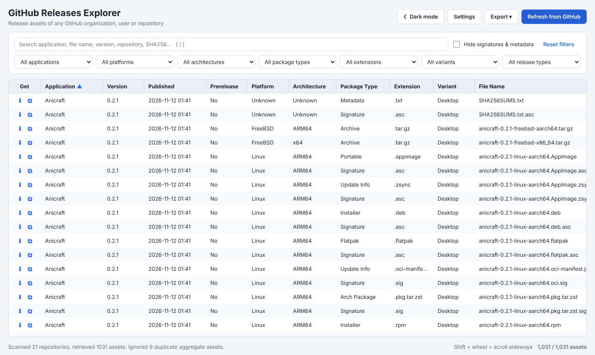

# GitHub Releases Explorer

**تصفّح وفلترة وتصدير ملفات الإصدارات لأي منظمة أو مستخدم أو مستودع على GitHub.** 
ملف HTML واحد (~50 كيلوبايت) · بلا تثبيت · بلا مكتبات · يعمل دون إنترنت بعد أول تحديث

[English](README.md) · [مقارنة مع أدوات مشابهة](docs/COMPARISON.md) · [سجل التغييرات](CHANGELOG.md)

## لماذا
GitHub يعرض الإصدارات مستودعاً بمستودع. هذه الأداة تقرأ GitHub API مباشرة من المتصفح وتجمع **كل ملفات الإصدارات في جدول واحد** قابل للفلترة
والترتيب، وتصدّر ما تراه تماماً إلى Excel أو CSV أو JSON.

## البدء السريع
1. افتح `index.html` بنقرة مزدوجة (أو استضفه على GitHub Pages). على ويندوز: `run.bat` يفتحه في نافذة تشبه التطبيق.
2. اضغط **Refresh from GitHub**. المثال المدمج يقرأ منظمة [`storytold`](https://github.com/storytold).
3. من **Settings** اكتب أي منظمة أو مستخدم أو `owner/repo` (يمكن عدة مصادر مفصولة بفواصل).

رابط مشاركة جاهز: `index.html#source=storytold&filter=craft&depth=3`

## المزايا
- **أي مصدر:** منظمات ومستخدمون ومستودعات محددة مع فلتر اختياري لاسم المستودع.
- **جدول على مستوى الملف:** التطبيق، الإصدار، التاريخ، المنصة، المعمارية، نوع الحزمة، الامتداد، الحجم، SHA256، الروابط.
- **فلاتر:** التطبيق، المنصة، المعمارية، نوع الحزمة، الامتداد، النوع، بحث متعدد الكلمات، إخفاء التواقيع، وزر **Reset filters** (أو `Esc`).
- **عمق السجل:** آخر 1 / 3 / 5 / 10 إصدارات لإيجاد ملفات (مثل `.exe`) لا توجد إلا في إصدارات أقدم.
- **مستودعات التجميع (Aggregate):** تُنسب ملفاتها للتطبيق الصحيح وتُزال التكرارات.
- **تصدير** الصفوف الظاهرة: XLSX وCSV وJSON.
- وضع فاتح/داكن، **Shift + دولاب الماوس** للتمرير أفقياً، جدول سريع مع آلاف الصفوف.
- **خصوصية:** بلا خادم ولا تتبع؛ سياسة CSP صارمة تسمح فقط بـ `api.github.com`؛ التوكن يبقى في الذاكرة فقط.

## حد طلبات GitHub
الوصول دون توكن 60 طلباً/ساعة، والتحديث يستهلك نحو طلب لكل مستودع. أضف توكناً شخصياً في **Settings** لرفع الحد إلى 5000.

## التحديث عبر `incoming/`
ضع **ملف zip واحداً** للمشروع في `incoming/` وادفعه؛ يتحقق الـ Action ثم يستبدل الملفات وينشئ وسم `v<VERSION>` وإصداراً.
إعدادات المستودع لمرة واحدة: [docs/PUBLISHING.md](docs/PUBLISHING.md).

## الترخيص
MIT
