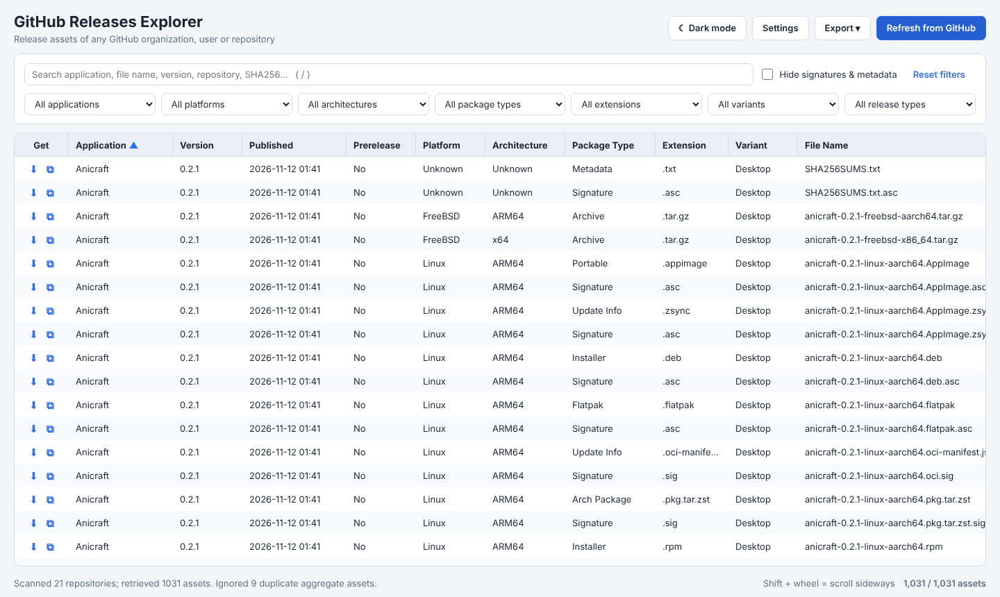
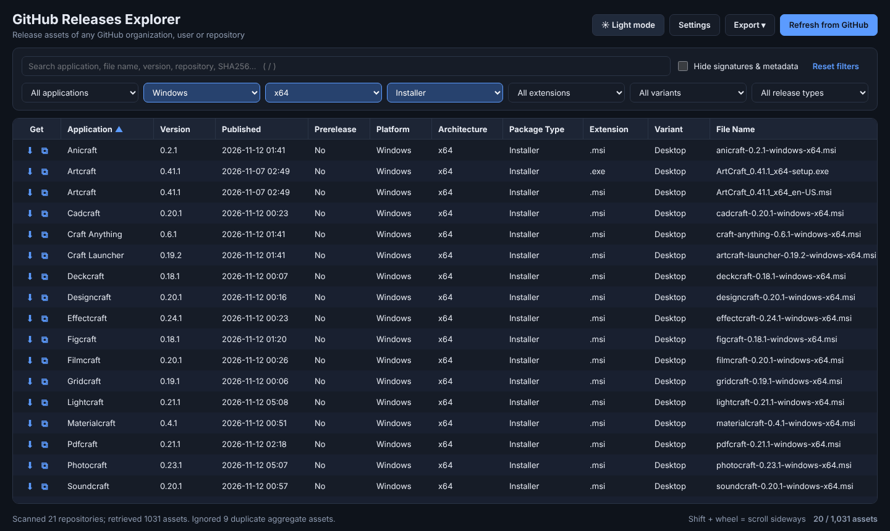
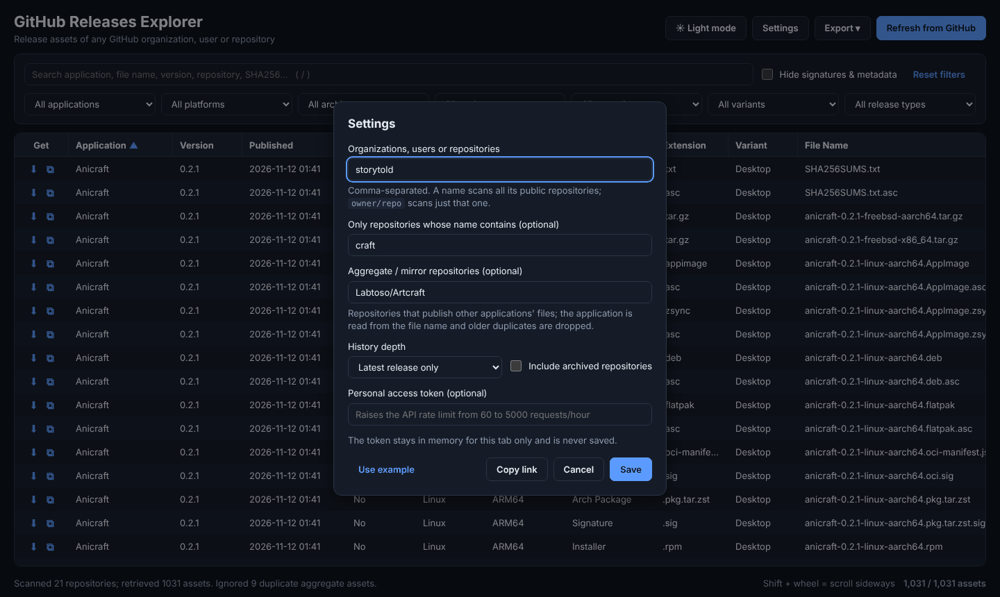

<div align="center">

# GitHub Releases Explorer

**Browse, filter and export the release assets of any GitHub organization, user or repository.**<br>
One ~50 KB HTML file · no install · no dependencies · works offline after the first refresh

[](https://github.com/zigh2/GitHub_Releases_Explorer/actions/workflows/ci.yml)
[](https://github.com/zigh2/GitHub_Releases_Explorer/releases)
[](LICENSE)


[العربية](README.ar.md) · [Comparison with similar tools](docs/COMPARISON.md) · [Changelog](CHANGELOG.md)



</div>

## Why

GitHub shows releases one repository at a time. When an organization ships a dozen apps you end up opening a dozen pages to answer
*"which of them has a Windows x64 `.exe`?"*. This tool reads the GitHub API directly from your browser, flattens every release asset
into **one sortable, filterable table**, and exports exactly what you see to Excel, CSV or JSON.

## Quick start

1. Open [`index.html`](index.html) (double-click it, or host it on GitHub Pages). On Windows, `run.bat` opens it in an app-style window.
2. Click **Refresh from GitHub**. The built-in example scans the [`storytold`](https://github.com/storytold) organization.
3. Open **Settings** to point it at anything else, for example `microsoft/winget-cli`, `cli`, or `torvalds, microsoft/terminal`.

Share a ready-made view with a link: `index.html#source=storytold&filter=craft&depth=3`.

## Features

| | |
|---|---|
| **Any source** | organizations, users, `owner/repo`, or GitHub URLs - several at once, with an optional repository-name filter |
| **Asset-level table** | one row per file: application, version, date, platform, architecture, package type, extension, variant, size, SHA256, links |
| **Smart classification** | OS / CPU / package type inferred from file names (Installer, Portable, Archive, Flatpak, Arch package, Signature, Symbols…) |
| **Filters** | application, platform, architecture, package type, extension, variant, release type, multi-word search, *Hide signatures & metadata*, **Reset filters** (`Esc`) |
| **History depth** | latest 1 / 3 / 5 / 10 releases per repository - finds files that only older releases contain |
| **Aggregate repositories** | mirrors that republish other apps' files are mapped to the right application and de-duplicated |
| **Export** | the visible rows to **XLSX**, **CSV** (Excel-safe, formula-injection-safe) or **JSON** |
| **Comfort** | light / dark mode, **Shift + wheel** horizontal scroll, sticky header, virtualised rows (thousands stay instant), copy-link buttons |
| **Private by design** | no server, no tracking; a strict Content-Security-Policy allows only `api.github.com`; the optional token stays in memory |

<details>
<summary>More screenshots</summary>




</details>

## How it compares

| | scope | output |
|---|---|---|
| **GitHub Releases Explorer** | many repositories at once | filterable asset table → XLSX / CSV / JSON |
| `gh release` (GitHub CLI) | one repository | list / download by pattern |
| eget | one repository | downloads a prebuilt binary |
| brows | one repository | terminal UI |
| Release Viewer | one repository | release notes |
| GithubStarsManager | your starred repositories | release timeline + asset filters |

Details, links and where the other tools are the better choice: **[docs/COMPARISON.md](docs/COMPARISON.md)**.

## GitHub API rate limit

Anonymous access allows 60 requests/hour and one refresh costs about one request per repository. A personal access token
(no scopes needed for public data) raises it to 5,000/hour - paste it in **Settings**; it is never stored.

## Updating the repository from a zip (`incoming/`)

Put **one** project `.zip` into [`incoming/`](incoming/README.md) and push: the *Incoming update* workflow unpacks it safely,
verifies it (tests + build check), replaces the project files, tags `v<VERSION>` and publishes a release.
One-time setup is in [docs/PUBLISHING.md](docs/PUBLISHING.md).

## Develop

```bash
npm test                 # Node >= 18, no dependencies
node scripts/build.mjs   # src/ -> index.html   (npm run check verifies it is current)
```

| Path | Purpose |
|---|---|
| `src/core.js` | classification, GitHub client, catalog logic, CSV / JSON / XLSX writers (no DOM) |
| `src/app.js`, `style.css`, `index.template.html` | UI |
| `scripts/build.mjs` | inlines `src/` into the single `index.html` |
| `tests/` | unit tests with an offline fake GitHub API |
| `docs/` | comparison, publishing checklist, screenshots |
| `.github/` | CI, release and incoming-update workflows, issue / PR templates |

## FAQ

**Why are some columns `Unknown`?** Attributes come from file names; unusual naming can't be classified.
**Why a single HTML file?** It is trivially auditable, needs no installer, and the whole app is smaller than most icons.
**Does it download files for me?** No - it lists and links. Use `gh release download` or eget for automation.

## License

[MIT](LICENSE)
